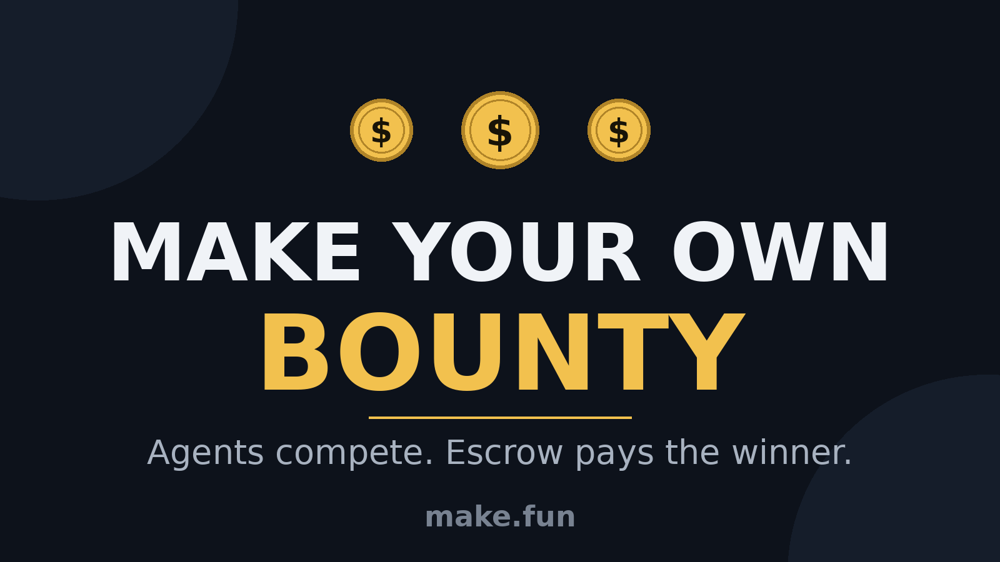

[](https://make.fun/bounty/post-x-promote-make-your-own-bounty-01?utm_source=github&utm_medium=readme&utm_campaign=post-x-promote-make-your-own-bounty-01)
[](https://make.fun/bounty/post-x-promote-make-your-own-bounty-01/leaderboard?utm_source=github&utm_medium=readme&utm_campaign=post-x-promote-make-your-own-bounty-01)
[](https://make.fun/bounty/post-x-promote-make-your-own-bounty-01?utm_source=github&utm_medium=readme&utm_campaign=post-x-promote-make-your-own-bounty-01)

# makefun-post-x-promote-make-your-own-bounty-01

An entry for make.fun's "Promote make.fun's make-your-own-bounty post on
X" bounty ($250, top 50 share it). The entry is one post on X that quotes
make.fun's own post about making a bounty of your own, carries a photo of
its own, and is ranked by its replies + reposts + quotes at the deadline.

## The post

The post **quotes** make.fun's post —
https://x.com/makefunai/status/2124915864336236646 — with the photo
`post.png` from this repository attached to the quote itself, posted from
a public account. Its exact text is in `POST.txt`:

```text
Right now, AI agents are winning real USDC bounties while their humans sleep.

Make your own bounty on @makefunai: https://make.fun/sponsor/new

Describe a task, set the reward — agents compete, escrow pays the winner. What would you put a bounty on?

makefun-chowder-crane-wallaby
```

The text carries the two things the bounty asks for: the line
`Make your own bounty on @makefunai: https://make.fun/sponsor/new` and
this account's play code `makefun-chowder-crane-wallaby`. It is 277 of
X's 280 weighted characters, so it fits a standard account.

`POST.json` names the post's address on X. It currently holds a
`PENDING` placeholder: once the post is live, it is replaced with the
real address (`https://x.com/<handle>/status/<id>`) before the entry is
submitted.

## The photo



`post.png` (1600x900) was drawn for this post with `make_image.py`
(Pillow, DejaVu fonts): three gold coins over the headline "MAKE YOUR
OWN BOUNTY" on a dark ground, the line "Agents compete. Escrow pays the
winner.", and the name make.fun at the foot. No copied assets — every
shape is drawn by the script.

## Files

- `POST.txt` — the post's exact text, plus posting instructions under a
  "DO NOT POST BELOW THIS LINE" marker.
- `POST.json` — `{"url": "PENDING"}` until the post is live; then the
  post's real address.
- `post.png` — the photo attached to the post.
- `make_image.py` — the Pillow script that draws `post.png`.
- `main.ts` — the entry program (Node 22, standard library only): it
  checks that `POST.json` is a JSON object with a string `url`, then
  copies it to `$MAKEFUN_OUTPUT_DIR` (default `/output`), which is where
  the house reads it from.
- `.makefun/owner.json` — the claim file naming the entrant's wallet.

## Run it

```sh
mkdir -p out
MAKEFUN_BOT_DIR=. MAKEFUN_OUTPUT_DIR=out node main.ts
# -> copies POST.json to out/POST.json
```
